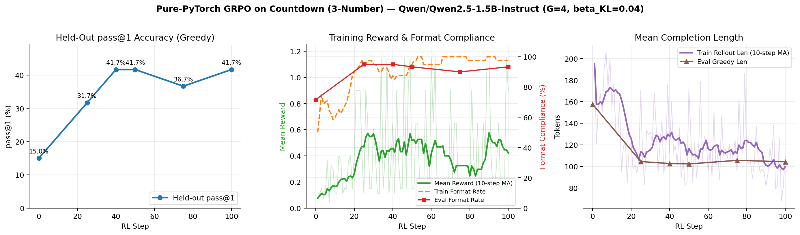
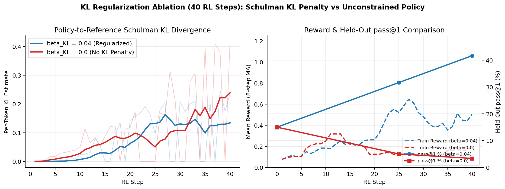

# TinyZero-GRPO: Pure PyTorch RLVR on Countdown

A clean, production-grade implementation of **Group Relative Policy Optimization (GRPO)** written **from scratch in pure PyTorch** (zero `trl`, `verl`, or `openrlhf`) to train `Qwen/Qwen2.5-1.5B-Instruct` on the **Countdown Numbers Game** with `<think>...</think><answer>...</answer>` reasoning traces, engineered to run end-to-end on a single **NVIDIA Tesla T4 (16 GB VRAM)**.

---

## Key Results (Tesla T4, 16 GB VRAM)

All experiments were executed end-to-end on a single **NVIDIA Tesla T4** (`torch.float16`, `Qwen/Qwen2.5-1.5B-Instruct` with `18.46M` trainable FP32 LoRA parameters out of `1.56B` total, `G=4`, `micro_batch_size=2`).

| Run / Checkpoint | Held-Out pass@1 (60 puzzles) | Format Compliance | Mean Reward | Mean Completion Length | Peak VRAM | Wall-Clock Time |
|---|---:|---:|---:|---:|---:|---:|
| Baseline (`Qwen2.5-1.5B-Instruct`, Step 0) | 15.0% | 71.7% | 0.258 | 157.7 tokens | — | — |
| GRPO (`G=4`, `beta_KL=0.04`, Step 50) | 41.7% | 93.3% | 0.557 | 102.3 tokens | 5.34 GB | — |
| GRPO (`G=4`, `beta_KL=0.04`, Step 100) | **41.7%** | 93.3% | **0.557** | 104.3 tokens | **5.34 GB** | 34.5 min |
| Ablation (`G=4`, `beta_KL=0.0`, Step 40) | 3.3% | 100.0% | 0.183 | 62.3 tokens | 5.34 GB | 15.5 min |





### Key Findings

- **Rapid RLVR Reasoning Gains (+26.7 pp pass@1)**: Held-out greedy `pass@1` climbs from **15.0%** (Step 0) to **31.7%** (Step 25) and **41.7%** (Step 40, maintained through Step 100), while format compliance rises from **71.7%** to **93.3%–95.0%**.
- **Concise, Focused CoT Traces**: Mean completion length drops from **157.7 tokens** (frequent 224-token truncation and rambling trial-and-error at Step 0) to **102–104 tokens**, as GRPO prunes dead-end arithmetic branches in favor of direct step-by-step verification.
- **KL Regularization Prevents Format-Only Mode Collapse**: Removing the Schulman KL penalty (`beta_KL=0.0`) causes KL divergence to spike to **0.417** by Step 40 (vs. **0.236** with `beta_KL=0.04`) and collapses the policy to short (**62.3 tokens**), 100% format-compliant guesses with **3.3%** `pass@1` (vs. **41.7%** with `beta_KL=0.04` at Step 40)—confirming `beta_KL=0.04` is essential on a 1.5B model. All runs stay at **5.34 GB** peak VRAM via `disable_adapter()` reference log-probs and micro-batching.

---

## Qualitative Reasoning Examples

Real held-out greedy generations from `experiments/results.json` comparing **Step 0** vs. **Step 100** (`beta_KL=0.04`):

### Example 1 — Puzzle #501: `Numbers = [12, 7, 13]`, `Target = 32`

**Before (Step 0 | `is_correct=False` | `reward=0.00` | `224` tokens, truncated):**
```text
<think>
To reach the target of 32, we can use the numbers 12, 7, and 13. One possible way is to first multiply 12 and 13 to get 156, then subtract 7 from it to get 149, but this doesn't work. Instead, let's try another approach: 
- Multiply 12 and 13 to get 156.
- Subtract 7 from 156 to get 149.
- Add 3 to 149 to get 152.
This works because 152 is close to 32, so we need to adjust our calculation slightly.

Let's try adding 12 directly instead of multiplying 12 and 13:
- Add 12 to 13 to get 25.
- Subtract 12 from 25 to get 13.
- Finally, add 7 to 13 to get 20.
This gives us 20, which is not
```

**After (Step 100 | `is_correct=True` | `reward=1.15` | `87` tokens):**
```text
<think>
To get 32 from 12, 7, and 13, we can use 13 + 12 = 25, then add 7 to make it 32.

So, 13 + 12 + 7 works with all numbers used exactly once.
</think>

<answer>((13 + 12) + 7)</answer>
```

### Example 2 — Puzzle #506: `Numbers = [20, 21, 17]`, `Target = 58`

**Before (Step 0 | `is_correct=False` | `reward=0.00` | `224` tokens, truncated):**
```text
<think>
To reach the target of 58, we can start by trying combinations involving multiplication and addition/subtraction. Let's try 20 * 21 = 420, which is too high. Instead, let's use 20 * 17 = 340, which is close but still higher than 58. We need to adjust this sum to get closer to 58.

Now, subtracting 6 from 340 gives us 334, which is still not 58. Let's try adding 17 instead of subtracting it. This way, we can adjust our approach more flexibly.

Let's calculate: 
(20 * 17) + 17 = 340 + 17 = 357

This is still too high. Let's try another combination:

(20 * 17) - 17 = 340 - 17 = 323

Still not there. Let's try adjusting further:

((20
```

**After (Step 100 | `is_correct=True` | `reward=1.15` | `86` tokens):**
```text
<think>
To get 58 from 20, 21, and 17, we can use 21 + 20 = 41, then add 17 to make it 58.

So, 21 + 20 + 17 works perfectly.
</think>

<answer>((21 + 20) + 17)</answer>
```

---

## RLVR Architecture Loop

```text
  +----------------------+      Sample G=4 rollouts       +-----------------------------+
  |  Countdown Puzzle q  | -----------------------------> |  Policy pi_theta (FP16 +    |
  |  ([n1, n2, n3] -> T) |      (T=0.8, max_tok=224)      |  FP32 LoRA, use_cache=True) |
  +----------------------+                                +-----------------------------+
                                                                        |
                                                                        v
  +----------------------+     AST + Exact Fraction       +-----------------------------+
  |  Group Rewards r_i   | <----------------------------- |  Strict RLVR Verifier       |
  |  {0.0, 0.15, 1.15}   |   format (+0.15) + math (+1.0) |  <think>...</think><answer> |
  +----------------------+                                +-----------------------------+
             |
             v  std(r) < 1e-6 -> skip update cleanly
  +----------------------+     Reference log-probs        +-----------------------------+
  |  Group Advantage A_i | -----------------------------> |  Zero-VRAM pi_ref           |
  |  (r_i - mean) / std  |                                |  model.disable_adapter()    |
  +----------------------+                                +-----------------------------+
                                                                        |
                                                                        v
                                                          +-----------------------------+
                                                          |  Micro-Batched GRPO Update  |
                                                          |  mb=2, GradScaler, FP32 KL  |
                                                          +-----------------------------+
```

---

## Mathematical Formulation

Given a prompt $q$ and a group of $G$ sampled completions $\{o_1, \dots, o_G\}$ from $\pi_{\theta_{\mathrm{old}}}$, each completion receives a deterministic rule-based RLVR reward $r_i \in \{0.0, 0.15, 1.15\}$ from the AST verifier.

### 1. Group-Relative Advantage Normalization

$$
A_i = \frac{r_i - \mathrm{mean}(r_1, \dots, r_G)}{\mathrm{std}(r_1, \dots, r_G) + \epsilon_{\mathrm{norm}}}
$$

When $\mathrm{std}(r_1, \dots, r_G) < 10^{-6}$ (all rollouts in the group succeed or fail identically), the gradient step is skipped cleanly.

### 2. Clipped Surrogate Objective & Unbiased Schulman KL

Let $m_{i,t} \in \{0, 1\}$ denote the completion mask (strictly `False` on prompt tokens, post-EOS tokens, and padding), and let $|o_i| = \sum_t m_{i,t}$. Defining the token likelihood ratio $r_{i,t}(\theta) = \frac{\pi_\theta(o_{i,t} \mid q, o_{i,<t})}{\pi_{\theta_{\mathrm{old}}}(o_{i,t} \mid q, o_{i,<t})}$, the GRPO loss minimized per group is:

$$
\mathcal{L}_{\mathrm{GRPO}}(\theta) = \frac{1}{G} \sum_{i=1}^{G} \frac{1}{|o_i|} \sum_{t=1}^{|o_i|} m_{i,t} \left[ -\min\left( r_{i,t}(\theta) A_i, \; \mathrm{clip}\left(r_{i,t}(\theta), 1 - \epsilon, 1 + \epsilon\right) A_i \right) + \beta_{\mathrm{KL}} \, \hat{D}_{\mathrm{KL}}\left(\pi_\theta \,\|\, \pi_{\mathrm{ref}}\right)_{i,t} \right]
$$

Following DeepSeekMath, the per-token KL divergence uses Schulman's non-negative unbiased `k3` estimator (clamped in `float32` for stability):

$$
\hat{D}_{\mathrm{KL}}\left(\pi_\theta \,\|\, \pi_{\mathrm{ref}}\right)_{i,t} = \exp\left(\Delta_{i,t}\right) - \Delta_{i,t} - 1, \qquad \Delta_{i,t} = \log \pi_{\mathrm{ref}}(o_{i,t} \mid q, o_{i,<t}) - \log \pi_\theta(o_{i,t} \mid q, o_{i,<t})
$$

---

## Tesla T4 (16 GB VRAM) Memory Engineering

- **Hardware-aware precision**: `get_compute_dtype()` inspects `torch.cuda.get_device_capability(0)` and selects `torch.float16` on Turing/Volta (`major < 8`, e.g., T4 `sm_75`) and `torch.bfloat16` only on Ampere+ (`major >= 8`).
- **FP32 LoRA + GradScaler**: Base weights stay frozen in FP16 (~3.0 GB), while PEFT LoRA adapters (`r=16`, `lora_alpha=32` on attention + MLP projections) stay in `float32` alongside `torch.amp.GradScaler("cuda")` so AdamW updates never underflow.
- **Zero-VRAM Reference Policy**: Instead of loading a second 1.5B parameter copy of $\pi_{\mathrm{ref}}$ (~3.0 GB extra), reference log-probabilities are computed via `with model.disable_adapter():` under `torch.no_grad()`.
- **Gradient Checkpointing + Micro-Batching**: Activation checkpointing (`use_reentrant=False`) paired with micro-batches of 2 completions (`loss * (mb_size / G)`) keeps peak VRAM well under 10 GB even for $G=8$.
- **FP32 Log-Softmax**: Logits are cast to `float32` before `F.log_softmax(logits.float(), dim=-1)` to eliminate FP16 softmax underflow/NaNs.

---

## Repository Structure

```text
tinyzero-grpo/
├── src/
│   ├── __init__.py          # Public package exports
│   ├── dataset.py           # Deterministic 3-number Countdown puzzle generator (500 train / 60 test)
│   ├── verifier.py          # Strict AST-based math verifier & RLVR reward (format + exact arithmetic)
│   ├── grpo.py              # Pure PyTorch GRPO loss, group advantage, completion mask, Schulman KL
│   └── trainer.py           # Memory-safe T4 training loop (rollouts -> rewards -> micro-batched updates)
├── tests/
│   └── test_grpo.py         # Fast CPU pytest suite (<10s, tiny Qwen2Config gradient flow & AST checks)
├── experiments/
│   ├── run_grpo.py          # CLI runner: Step 0 baseline -> GRPO -> periodic held-out eval -> KL ablation
│   └── plot_results.py      # Generates learning curves & ablation figures into assets/
├── notebooks/
│   └── run_t4_grpo.ipynb    # 1-click Google Colab T4 notebook
├── assets/
├── requirements.txt
└── README.md
```

---

## Reproduction

### 1. Local CPU Verification (< 10 seconds, zero downloads)

```bash
pip install -r requirements.txt
PYTHONPATH=. pytest tests/ -v
```

### 2. Full T4 GPU Training & Ablation (Google Colab)

Open [`notebooks/run_t4_grpo.ipynb`](notebooks/run_t4_grpo.ipynb) in Google Colab with a **T4 GPU** runtime and run all 4 cells, or run the CLI directly on a CUDA machine:

```bash
PYTHONPATH=. python experiments/run_grpo.py
PYTHONPATH=. python experiments/plot_results.py
```
